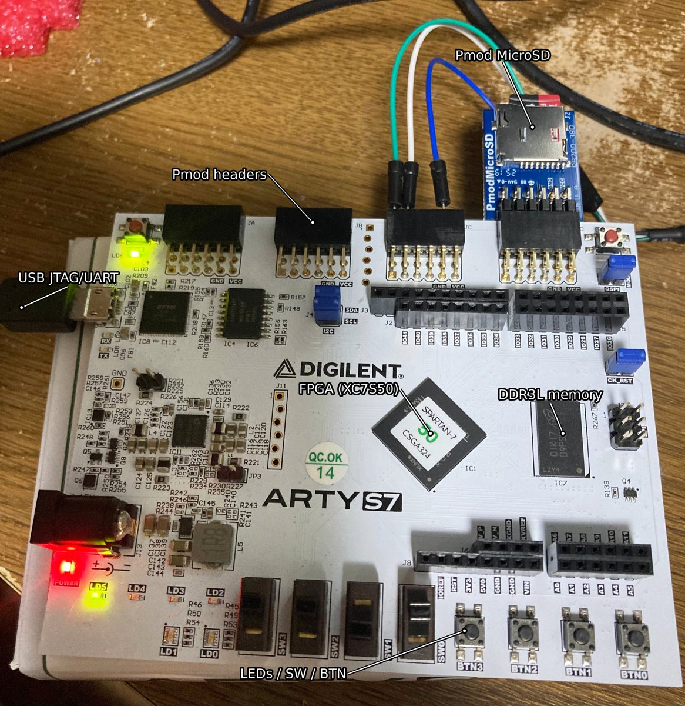

# r-vax: DEC VAX Verilog code.

### A VAX 8600-compatible core running 4.3BSD and VMS on a small FPGA

> **This fork (branch `arty-s7`): 4.3BSD and VMS on a Digilent Arty S7-50.** The
> MiSTer branch's r-vax core, which implements the VAX 8600 as software
> sees it, runs on the Arty S7-50 with DDR3L main memory and an RP07 on a
> microSD card, and boots the unmodified 4.3BSD GENERIC kernel to
> multi-user mode at power-up. 4.3BSD takes it for a VAX 8600, and so does
> VMS: VAX/VMS V4.6 (1987) boots from another card in 33 seconds and takes
> logins on the console and the DZ11 line. It is not a copy of DEC's 8600
> hardware, and much slower: about 1.1 million instructions a second at 40
> MHz on a simple loop (`software/bench.bin`), not comparable with DEC's
> VUP ratings.
> See [arty/README.md](arty/README.md).
>
> 
>
> 
>
> 
>
> Built on r-vax by Anders Magnusson and its MiSTer branch by Maverick-Shark,
> with 4.3BSD from CSRG, UC Berkeley, kept by TUHS; see the
> [acknowledgements](arty/README.md#acknowledgements).
>
> Upstream: [Maverick-Shark/dec_vax](https://github.com/Maverick-Shark/dec_vax)
> (MiSTer branch). The text below is upstream's.

This is an basic implementation of the DEC VAX cpu.  It was written by me for a way to learn verilog, hence not pretty.  I also assume it is quite incorrect in quite some places.

It implements the Vax basic instruction set and passes the **EVKAA.EXE** basic instruction set test program.

There are quite some parts missing; for example memory management and floating point instructions.

It runs on the Waveshare Open3S500E Spartan-3 board.  
Code for simulation in Verilator also exist and works.

## MiSTer port

This branch adds a MiSTer (DE10-Nano) version of r-vax: CPU, 32 MB SDRAM,
on-screen VT100-style console terminal and USB keyboard. See
[README_MiSTer.md](README_MiSTer.md).
