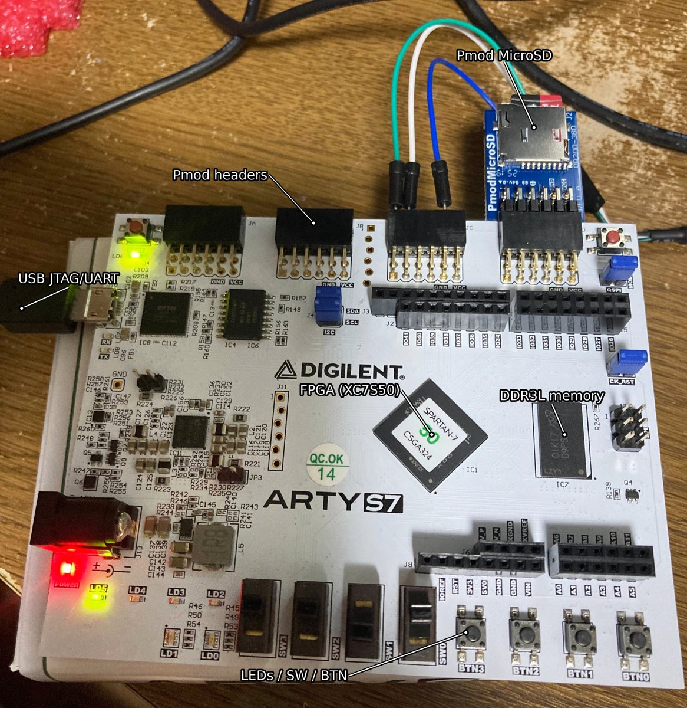

# r-vax on the Digilent Arty S7-50: 4.3BSD and VMS

This directory puts the r-vax core (`../rtl`, the MiSTer branch) on a
Digilent Arty S7-50 and boots **4.3BSD** (June 1986, the GENERIC kernel,
unmodified) to multi-user mode from a microSD card. It also boots
**VAX/VMS V4.6** (1987) from its own card, with logins on the console and
the DZ11 line (see [VMS](#vms)).

r-vax is a VAX written in Verilog. The MiSTer branch implements the VAX
8600 as software sees it: its system ID, internal registers, memory
management, machine checks and console halt codes, and its I/O side (the
physical address map, SBIA, RH780, UBA), after DEC's 8600 documents. It
is not a copy of the 8600's hardware (an ECL pipelined machine), and it
is much slower. On a simple loop, `software/bench.bin` (ADDL2, MOVL
store, MOVL load, SOBGTR, timed with the interval clock), it runs about
1.1 million instructions a second at 40 MHz here (1.094, 36.6 clocks an
instruction); heavier instructions take longer. This is not comparable
with DEC's VUP ratings (the 8600 was rated at about 4 times a VAX-11/780).

4.3BSD takes it for a VAX 8600. The kernel reads the system ID at boot and
sets `cpu`; on the board:

```
# echo "cpu/D" | adb -k /vmunix /dev/mem
_cpu:           4
# grep VAX_8600 /usr/sys/vax/cpu.h
#define VAX_8600        4
```

and its autoconfiguration takes the 8600's path (`SBIA0 at IO adaptor 0`
in the boot messages below).


The console of the board, recorded from power-up to `login:` (100 s;
pauses over 2 s cut short). `docs/boot-43bsd.cast` is the recording with
its real times (asciinema v2; `tools/concast.py` made it).

```
4.3 BSD UNIX #1: Fri Jun  6 19:55:29 PDT 1986
real mem  = 33554432
avail mem = 31727616
SBIA0 at IO adaptor 0 address 0x20080000
uba0 at tr3
dz0 at uba0 csr 160100 vec 300, ipl 15
mba0 at tr8
hp0 at mba0 drive 0
Changing root device to hp0a
...
4.3 BSD UNIX (myname.my.domain) (console)

login: root
```

At power-up the FPGA loads from its SPI flash, the boot ROM puts 4.3BSD's
`/boot` at address 0 and starts it, `/boot` reads `hp(0,0)vmunix` from the
SD card, and the kernel checks the file systems and runs `/etc/rc`: about
two minutes to `login:`. `reboot` boots again; `shutdown -h now` halts in
the console monitor.

## VMS


**VAX/VMS V4.6** (June 1987) boots on the same bitstream from its own card:
with SW1 on, the boot ROM starts VMB, then SYSBOOT, STARTUP, and the
login, 33 seconds from RESET to the end of STARTUP, no date asked. VMS V4 has no license management, so it takes logins on
the DZ11 line too: SYSTEM logged in on the console (OPA0) and on `tty00`'s
Pmod JC terminal (TTA0) at the same time:

```
$ show system
VAX/VMS  KG   on node  26-NOV-2026 23:09:57.16   Uptime    0 00:35:02
  Pid    Process Name    State  Pri      I/O       CPU       Page flts Ph.Mem
00000100 NULL            COM      0        0   0 00:34:44.91         0      0
00000101 SWAPPER         HIB     16        0   0 00:00:00.14         0      0
00000104 ERRFMT          HIB      8       29   0 00:00:00.23        70     98
00000105 OPCOM           LEF      8       44   0 00:00:00.40       173     53
00000106 JOB_CONTROL     HIB      8       20   0 00:00:00.23        83    213
00000107 SYSTEM          CUR      4      129   0 00:00:02.16       807    275
00000109 _TTA0:          LEF      7       56   0 00:00:00.92       320    238
```

The recording (`docs/boot-vms46.cast`, `tools/vmscast.py --rom`, real
times; pauses over 2 s cut short in the GIF) goes from RESET to
`show device d`, 37 s.

Two changes to the core, found while bringing up a later VMS, are in the
bitstream; both are tested against SIMH's `vax8600` in `tests/mmu`:

- **The 8600's console subchannels** (`rtl/cpu.v`). TXCS<19:16> enables
  the lines, TXCS<11:8> names the line TXDB goes to, and the logical
  console (line 3) answers the microcode version (function 12), the array
  configuration (13), snapshot status (30) and cancel (70), as SIMH's
  `vax860_stddev.c`. SYSBOOT asks the logical console for the microcode
  version and waits for line 3. (t70, t71)
- **REMQUE restartable** (`rtl/ucode.def`). REMQUE wrote the predecessor's
  link before the successor's could be written; a page fault on the second
  write then made the restart remove the wrong entry, and STARTUP looped
  on a broken queue in P1. Both places are now write-checked first.
  (t69, t72; also sent upstream as
  [Maverick-Shark/dec_vax#2](https://github.com/Maverick-Shark/dec_vax/pull/2))

### What you need for VMS

VMS is not in this repository and is not downloaded by it: you need your
own distribution and the right to use it.

- A second microSD card (1 GB or more) for the VMS disk; the 4.3BSD card
  stays as it is.
- SIMH's `vax8600` to install VMS, and VMB.EXE, the VAX boot program,
  from open-simh: `VAX/vmb.exe` in its source tree.
- The VAX/VMS V4.6 distribution tape BB-BT05D-BE as a SIMH tape image
  (four save sets: VMS046.A, REQUIRED, LIBRARY, OPTIONAL).
- `ods2` from open-simh's [simtools](https://github.com/open-simh/simtools)
  (`extracters/ods2`; `make -f makefile.unix DEFS=-D_FILE_OFFSET_BITS=64
  LDLIBS= VHDOPTS=/dev/null` builds it without libedit), in PATH or as
  `$ODS2`. The 8600's standalone BACKUP came on the console's own medium,
  not on this tape; the install makes one from the tape's own files with
  it (`vms/stabackit.py`).

### Install VAX/VMS V4.6 in SIMH

```sh
VMS_PASSWORD=... make vms46 TAPE=BB-BT05D-BE_VMS_4.6_87.tap.gz
```

makes `vms/work/vms46-rp07.dsk` unattended, in about 3 minutes
(`vms/mkvms46.py`; the whole console goes to `vms/work/mkvms46.log`).
`VMS_PASSWORD` becomes the new system's SYSTEM, SYSTEST and FIELD
password. What it does:

1. It builds a standalone BACKUP disk on the host, as STABACKIT.COM
   would on a running VMS: SYSBOOT, SYS.EXE, the drivers, STASYSGEN.EXE
   as SYSINIT.EXE and STABACKUP.EXE as STANDALON.EXE, from the tape's
   REQUIRED and LIBRARY save sets into [SYS0.SYSEXE] of a new Files-11
   RP07 (`vms/stabackit.py`, with `ods2`).
2. SIMH boots it from RP07 unit 0 (`boot rp0/R5:1`, with STABACKIT's
   SYSGEN parameters typed to SYSBOOT), with the new disk on unit 1 and
   the tape on TU0, and standalone BACKUP restores REQUIRED, an image
   save set:

   ```
   $ backup/image/verify mta0:required/save_set/rewind dra1:
   ```

   (`%BACKUP-E-NOBADDATA` for a new disk image does no harm.) Instead,
   `HELPER=` an RP07 image with a VMS that boots in SIMH's `vax8600` and
   has BACKUP, and its SYSTEM password in `HELPER_PASSWORD`, does the
   restore on that VMS (copied, never changed).
3. `boot rp1`: VAX/VMS V4.6 starts and goes on with the install. It
   answers the date, `MTA0` for the drive holding the kit, no to the two
   cluster questions; the install restores LIBRARY and OPTIONAL from the
   tape, takes the passwords, runs AUTOGEN and reboots.
4. It logs in, sets DUMPBUG to 0, shows the system, and shuts it down.

A question it does not know stops it, with the question shown. Write the
disk to the VMS card (check the device name first):

```sh
sudo dd if=vms/work/vms46-rp07.dsk of=/dev/sdX bs=1M conv=fsync
```

### Boot

VMS is booted as the 8600's console would: VMB at 200, started with R0-R5
set for an RP07 on the RH780 at TR 8, unit 0, and VMB's memory test
skipped. The system disk is then DRA0. Two ways:

**From the boot ROM**, with nothing but the board: when the bitstream was
built with `make bit VMB=vmb.exe`, the boot ROM holds VMB too
(`tools/mkbootrom.py --vmb`: VMB at 8200, a start past it that moves it
to 200 and jumps to it, and at 8000 a jump to that start). Put the VMS
card in, turn **SW0 off and SW1 on**, and power on (or press RESET): the
ROM is copied to 0 and started at 8000 instead of 2. The board's TODR has
no battery and starts in July at every configuration, earlier than the
time VMS saved at its last shutdown, so VMS would ask for the date;
`make vms46` sets the SYSGEN parameter TIMEPROMPTWAIT to 0, and VMS comes
up with the time it saved last instead (`show time`, then `set time` if
it matters). On a disk made before, set it as DUMPBUG below.

**Over the console UART**, with the time from the host:

1. Put the VMS card in the Pmod MicroSD, turn **SW0 on** (no boot from the
   ROM), and press RESET (or load the bitstream).
2. Send VMB (`tools/mkvmsboot.py`: VMB at 200, the start at 18000) and
   record the console:

   ```sh
   python3 tools/vmscast.py --vmb vmb.exe -o vms.cast
   ```

   `--vmb` makes the download frame just before it sends it, and the start
   first writes the TODR with the time then, in VMS's form (10000000 +
   hundredths of a second since 1 January, local time), as SIMH's 8600
   does: VMS takes the host's time, with no prompt whatever
   TIMEPROMPTWAIT is (checked on the board: `show time` agreed with the
   host). `-w`/`-k` pairs type the login.
   VMS shows `Username:` only after a key, so wait for the end of STARTUP
   (on later versions the audit server's message during STARTUP has a
   `Username:` too):

   ```sh
   python3 tools/vmscast.py --vmb vmb.exe -o vms.cast \
     -w "job terminated" -k '\r' \
     -w "Username: " -k 'SYSTEM\r' -w "Password: " -k 'password\r'
   ```

   Or make a frame with
   `tools/mkvmsboot.py vmb.exe -o vmsboot.vxld` and send it with
   `tools/vaxcon.py -f vmsboot.vxld`, then use a terminal program.
3. The DZ11 line (Pmod JC) is TTA0: 9600, 8 bits, no parity under VMS.
4. Before turning the power off, `@sys$system:shutdown` and wait for
   `SYSTEM SHUTDOWN COMPLETE`. `make vms46` sets the SYSGEN parameter
   DUMPBUG to 0; with 1 (V4.6's default) the shutdown's last step writes
   a crash dump of the 32 MB to SYSDUMP.DMP through the SD card a block at
   a time, a few minutes with nothing on the console. On a disk made
   before, set it once (it takes effect at the next boot):

   ```
   $ run sys$system:sysgen
   SYSGEN> use current
   SYSGEN> set dumpbug 0
   SYSGEN> set timepromptwait 0
   SYSGEN> write current
   SYSGEN> exit
   ```

   and add `DUMPBUG=0` and `TIMEPROMPTWAIT=0` to
   `SYS$SYSTEM:MODPARAMS.DAT` so that AUTOGEN keeps them.

VMS used to halt now and then early in its boot (halt code 5, a machine
check while an interrupt is being initiated; V4.6 once in 7 boots): the
interrupt microcode read the requested level twice, and a timer request
that came between the two reads sent a software interrupt down the
hardware path. Fixed in `rtl/ucode.def` (test `tests/mmu/t73`); with it,
V4.6 booted from the ROM 20 times in a row on the board.

### VMS quick reference

What a newcomer to VAX/VMS V4.6 needs on this board, each tried on it or
on SIMH's `vax8600` with the same disk (Ctrl+S / Ctrl+Q excepted). DCL
takes abbreviations (`dir` for `DIRECTORY`) and does not care about case.
The console (OPA0) is set up as a hardcopy LA36, so EDT works in line
mode.

| | |
|---|---|
| Log in | after `job terminated`, Return; `Username:` SYSTEM, the password |
| Log out | `logout` |
| Interrupt, cancel | Ctrl+Y (back to `$`), Ctrl+C; Ctrl+U clears the line; Ctrl+S / Ctrl+Q stop and go on |
| Help | `help`, `help show time`; Return at each `Topic?` / `Subtopic?` until `$` |
| Who, what | `show system`, `show users`, `show process`, `show memory/physical` |
| Disks | `show device d` (DRA0 the system disk) |
| Time | `show time`; `set time=27-NOV-2026:23:31:00` (after a power-off VMS has the time of its last shutdown) |
| Where am I | `show default`; `set default sys$login` (home), `set default [.work]`, `set default [-]` (up) |
| List files | `directory`, `directory/size *.txt`, `directory sys$system:*.par` |
| Make a file | `create hello.txt`, type the lines, Ctrl+Z |
| Look at a file | `type hello.txt` |
| Copy, rename | `copy a.txt b.txt`, `rename b.txt c.txt` |
| Delete | `delete c.txt;*` (every version); `purge` keeps only the newest of each file |
| Directories | `create/directory [.work]`; delete an empty one as a file: `delete work.dir;*` |
| Edit | `edit hello.txt` (EDT, line mode, `*` prompt: `type whole`; `insert` puts lines before the current one, Ctrl+Z ends them; `exit` saves a new version, `quit` does not) |
| Add a user | `set default sys$system`, `mcr authorize`, then `add guest/password=guestpw/uic=[200,1]/device=sys$sysdevice/directory=[guest]/owner="Guest"` and `exit`; then `create/directory sys$sysdevice:[guest]/owner=[200,1]`. The password comes expired: `set password` at the first login |
| System parameters | `run sys$system:sysgen`: `use current`, `show dumpbug`, `set ...`, `write current`, `exit` (the next boot); and the same in `SYS$SYSTEM:MODPARAMS.DAT` for AUTOGEN |
| Second terminal | the DZ11 line on Pmod JC, TTA0: 9600, 8 bits, no parity; Return for `Username:` |
| Shut down | `@sys$system:shutdown`: 0 minutes, a reason, Return for the rest, until `SYSTEM SHUTDOWN COMPLETE`; then power off or RESET |

`mcr authorize` opens SYSUAF.DAT in the current directory: run it from
SYS$SYSTEM, or it asks whether to create a new, empty one (answer N).

### Compilers

VAX C V2.4 (1988) and VAX FORTRAN V4.7 (1987), DEC's own kits of the
time, install on V4.6 with VMSINSTAL (in SIMH's `vax8600`, then the disk
goes to the card) and compile, link and run on the board; `cc` takes
about 5 seconds for a short program:

```
$ cc hello
$ link hello,sys$library:vaxcrtl/lib
$ run hello
hello from VAX C on the FPGA VAX 8600: 1
...
$ fortran hellof
$ link hellof
$ run hellof
hello from VAX FORTRAN on the FPGA VAX 8600: 1
...
```

How to install them: to come.

## The system



| | |
|---|---|
| CPU | r-vax at 40 MHz, as a VAX 8600 (SBIA, RH780, UBA) |
| Memory | 32 MB of the board's DDR3L, through the Xilinx MIG (`rtl/arty_mem_mig.v`) |
| Disk | RP07 unit 0 on a microSD card, raw from sector 0 (Pmod MicroSD on **JD**; `rtl/arty_sdcard.v`, sdspi) |
| Console | the board's USB UART, 115200 8N1 |
| Terminal | DZ11 line 0 (`tty00`) on Pmod **JC**: JC1 TX out, JC2 RX in, JC5 GND, 3.3 V. 9600, 7 bits, even parity |
| Boot ROM | 4.3BSD's `/boot` (32 KB), loaded at 0 after reset |

The core's changes for this board are each behind a define, so the MiSTer
build is the same as before: `CLK_MHZ` (interval clock), `MEMKB` (memory
smaller than the console's map), `ARTY_LUTRAM`, `VAX_EXT_MEM` (the memory
port outside `vax_core`), `VAX_UNIBUS` (the UBA's device side outside).

Switches and LEDs:

- **SW0** on: no boot from the ROM after reset; the console monitor waits
  (for downloads with `tools/vaxcon.py` and `tools/mkvxld.py`).
- **SW1** on (SW0 off): the boot ROM boots VMS (VMB) instead of 4.3BSD's
  `/boot`, if the ROM was built with `VMB=`.
- **RESET** button: the whole system again (the MIG keeps its calibration).
- LEDs (LD2-LD5, `led[0]`-`led[3]`): CPU running (blinks), CPU halted,
  DDR3 calibrated, download. RGB LED 1 green: SD card ready; red: an SD
  transfer failed.

## What you need

- Digilent Arty S7-50 (xc7s50csga324-1), the MODE jumper JP1 on (boot from
  the SPI flash, as it comes).
- Digilent Pmod MicroSD on JD, and a microSD card of 1 GB or more. Its
  contents are overwritten from sector 0.
- Optional: a 3.3 V USB-UART on JC for `tty00`.
- Vivado 2025.2 (other recent versions should do; the MIG is generated by
  `tcl/mig.tcl`). Set `VIVADO_SETTINGS` to its `settings64.sh`.
- SIMH's `vax8600` (open-simh), in `PATH` or as `VAX8600=...`, curl,
  python3. For the bench: Verilator 5.

### Development environment

All of this was developed and tested on **Windows 11** with **WSL2,
Ubuntu 24.04 LTS**:

- Vivado 2025.2 for Linux, installed inside WSL; Verilator 5.020; Open
  SIMH V4.1-0 (`vax8600`, git 87eb7d5e); Python 3.12.
- The board's USB (JTAG and the console UART, `/dev/ttyUSB1`), the USB-UART
  on JC and the microSD card reader reach WSL through
  [usbipd-win](https://github.com/dorssel/usbipd-win), from PowerShell:
  `usbipd list`, then `usbipd attach --wsl --busid <id>`. The card then
  shows up as a block device (`/dev/sdX`) for `dd`.
- Writing the card from Windows itself (`\\.\PhysicalDriveN`) was refused;
  `dd` in WSL through usbipd works.

A native Linux machine should work the same way, without usbipd.

## Build and run

```sh
cd arty
make disk        # 4.3BSD from TUHS, installed by SIMH: 43bsd/work/43bsd-rp07.dsk
make bit         # boot ROM, MIG, bitstream: build/vivado/arty_top_b.bit
                 # (VMB=.../open-simh/VAX/vmb.exe: the ROM boots VMS too)
```

`make disk` takes a minute or two after the download (110 MB). It runs
`43bsd/make43.sh`: the distribution tape for SIMH (`mktap.py`), then three
SIMH scripts with expect/send:

1. `inst1.ini` the miniroot, `xtr`: the root file system on hp0a.
2. `inst2.ini` `newfs` hp0h, `/usr` and `/usr/sys` from the tape.
3. `inst3.ini` for this board: `/etc/fstab` without hp0g (not made),
   `MAKEDEV dz0`, a getty on `tty00` only (`/etc/ttys`, the original in
   `/etc/ttys.orig`), and `/boot` copied to a tape. That `/boot` becomes the
   boot ROM (`make bootrom`, `tools/mkbootrom.py`).

Write the disk to the card (check the device name first: this overwrites
it):

```sh
sudo dd if=43bsd/work/43bsd-rp07.dsk of=/dev/sdX bs=1M conv=fsync
```

Then load the bitstream:

```sh
make program     # over JTAG, until power-off
make flash       # into the SPI flash: 4.3BSD at every power-up
```

and open the console with a terminal program (picocom, Tera Term, ...) at
115200 8N1. Log in as `root` (no password). (`tools/vaxcon.py` is for
scripts: it listens, and types only what `-k` gives it.)
Before turning the power off, `sync` or `shutdown -h now`.

These steps were checked end to end on the board: a disk from `make disk`
(fetched from TUHS), written to the card with `dd`, and the bitstream from
`make bit` loaded with `make program` boot to `login:` in 98 s.

## The bitstream

**A prebuilt one**, to try the board without building:
[`releases/arty-s7_20261128.bit`](../releases/arty-s7_20261128.bit)
(sha256 `db3389233243640d3afaeeab242e3533f01e3c58cd391b08bd5a1c8aed09ce40`),
built by `make bit VMB=vmb.exe` from 60c69b4 (with the fix for halt code
5; VMS V4.6 booted from its ROM 20 times in a row on the board). Its boot
ROM holds 4.3BSD's `/boot` and VMB (open-simh's `VAX/vmb.exe`): SW1 off boots 4.3BSD, SW1 on boots VMS, from the card in
the slot. Load it with Vivado (or Vivado Lab), from `arty/`:

```sh
vivado -mode batch -nojournal -nolog -source tcl/program.tcl -tclargs ../releases/arty-s7_20261128.bit   # JTAG
vivado -mode batch -nojournal -nolog -source tcl/flash.tcl -tclargs ../releases/arty-s7_20261128.bit     # SPI flash
```

The disks are not included: `make disk` for 4.3BSD, `make vms46` for
VMS (above). It is a work in progress.

Opening the console UART on the host can reset the board (then, with SW1
on, the boot ROM boots VMS again). That is the board, not the design:
with the jumper JP2 on, the FT2232's DTR is wired to CK_RST, the RESET
button's net (for an Arduino-style reset of a soft processor), and DTR
going from off to on resets everything. Take JP2 off (the RESET button
still works), or else turn HUPCL off once after the board's USB comes
up, before the VAX is started (`stty -F /dev/ttyUSB1 -hupcl`; that open
resets it once): later opens and closes leave DTR on and do not reset.

The figures below are for this bitstream, as built by
`make bit VMB=vmb.exe` from the sources with the VMS changes and the
80 KB boot ROM (Vivado 2025.2, non-project flow, `tcl/build.tcl`):

| | |
|---|---|
| Part | xc7s50csga324-1 (Spartan-7 50) |
| Top | `arty_top_b` |
| Defines | `MISTER CLKPERBIT=16 CACHEIDX=10 CLK_MHZ=40 VAX_EXT_MEM ARTY_MEM_KB=32768 ARTY_SD ARTY_BOOTROM VAX_UNIBUS ARTY_DZ` |
| Clocks | 100 MHz in → MMCM: core 40 MHz, MIG system 160 MHz, MIG reference 200 MHz; MIG UI 80 MHz (DDR3L at 320 MHz, 640 MT/s) |
| MIG | mig_7series 4.2, MT41K128M16XX-15E (DDR3L 1.35 V, x16), 3125 ps, PHY 4:1, BL8, native interface; 32 MB of the 256 MB used |
| Timing | WNS +1.240 ns, WHS +0.016 ns (all constraints met), both on the core clock; the MIG UI clock: WNS +4.238 ns |
| Configuration | SPI x4, 33 MHz, compressed; `USR_ACCESS` = build time |

Utilization after routing:

| Resource | Used | Available | % |
|---|---:|---:|---:|
| Slice LUTs | 29,098 | 32,600 | 89.3 |
| &nbsp;&nbsp;as logic | 27,997 | 32,600 | 85.9 |
| &nbsp;&nbsp;as memory | 1,101 | 9,600 | 11.5 |
| Slice registers | 16,205 | 65,200 | 24.9 |
| Block RAM tiles | 50 | 75 | 66.7 |
| DSPs | 23 | 120 | 19.2 |
| MMCM / PLL | 2 / 1 | 5 / 5 | |
| I/O | 70 | 210 | 33.3 |

By block (LUTs): `vax_core` 22,789 (of it the CPU 16,957), the MIG 3,703,
the SD card 807, the DZ11 346, the MIG bridge 71. The block RAM holds the
16 KB cache, the microcode (18 tiles in `vax_core`) and the 80 KB boot ROM
(32 tiles: its address is 15 bits, and Vivado builds it 32768 deep).

Build times on an 8-thread run: `make mig` about 3 minutes, `make bit`
about 8 minutes. The reports are in `build/vivado/` (`rou_util.rpt`,
`rou_util_h.rpt`, `rou_tim.rpt`).

## Bench

```sh
make simb        # Verilator: arty_sys with models of the MIG's UI and the SD card
make simboot     # boots 4.3BSD from 43bsd/work/43bsd-rp07.dsk (SIMCLOCKS=...)
```

The bench reads the disk image and never writes it (blocks written stay in
memory). It is slow, about 600,000 clocks a second: the default 400 million
clocks (11 minutes) reach `Changing root device to hp0a`, and the bench
stops with `TIMEOUT`.

VMS runs on the bench too, without the boot ROM, at about 800,000 clocks
a second, some 50 times slower than the board:

```sh
make simb BOOTROM=0                   # build/simb0
python3 tools/mkvmsboot.py vmb.exe -o build/vmsboot.vxld
cd build && ln -sfn ../../rtl rtl && SDIMG=/path/to/vms46-rp07.dsk \
  simb0/Vsim_b_top vmsboot.vxld 12000000000
```

To type into it (`KEYWAIT`, `KEYS`), leave `KEYGAP=80000` clocks after each
key: VMS reads the console one character at a time. `make simb BOOTROM=0
SIM_DEFS=-DVAX_WATCH` logs every CPU write to the virtual longwords
7FFE2680-7FFE269F, with the clock and the PC (how the REMQUE bug was found;
change the range in `sim/sim_b_top.v`).

## Files

| | |
|---|---|
| `rtl/arty_top_b.v` | the top: clocks (100 MHz → 40 MHz core, 160/200 MHz MIG), reset, LEDs, reboot |
| `rtl/arty_sys.v` | `vax_core`, the console UART and download loader, the boot ROM |
| `rtl/arty_mem_mig.v` | the core's memory port to the MIG's UI (one cache line = one BL8) |
| `rtl/arty_sdcard.v` | the RP07's block requests to sdspi (CMD18 reads, CMD24 writes) |
| `rtl/arty_dz11.v` | a DZ11 on the UBA's device side, line 0 to Pmod JC |
| `rtl/sdspi/` | SD card in SPI mode (MIT) |
| `xdc/`, `tcl/` | constraints; Vivado scripts (MIG, bitstream, JTAG, flash) |
| `sim/` | the bench: `sim_b_top.v`, MIG and SD models, `tb_arty.cpp` |
| `tools/` | `vaxcon.py` (console scripts), `mkvxld.py` (download frames), `mkbootrom.py`, `concast.py` (console recording), `mkvmsboot.py` (VMB boot frames), `vmscast.py` (VMS boot and recording) |
| `43bsd/` | the 4.3BSD install: `make43.sh`, `mktap.py`, SIMH scripts |
| `vms/` | the VAX/VMS V4.6 install: `mkvms46.py` (SIMH on a pty), `stabackit.py` (standalone BACKUP from the tape) |

4.3BSD itself is not in this repository; `make disk` fetches it from
[TUHS](https://www.tuhs.org/Archive/Distributions/UCB/4BSD/4.3BSD/) (the
Caldera license for ancient UNIX). Nor is VMS, or VMB.EXE.

## Acknowledgements

- **Anders Magnusson** wrote r-vax, the VAX in Verilog this all runs on.
- **Maverick-Shark** made the MiSTer branch: the VAX 8600's memory
  management, I/O side (SBIA, RH780, RP07, UBA), console and tests, after
  DEC's documents. 4.3BSD boots because that work is so close to the 8600.
- The **Computer Systems Research Group, University of California,
  Berkeley**, for 4.3BSD.
- **The Unix Heritage Society (TUHS)** and Warren Toomey, for keeping the
  4.3BSD distribution, and Caldera for its license for ancient UNIX.
- **SIMH** (Bob Supnik and the open-simh contributors): its `vax8600`
  installs 4.3BSD and VMS here, and served as the reference for the
  core's tests; its `vax860_stddev.c` showed the 8600's console
  subchannels and TODR, and its `vmb.exe` boots VMS.
- The Computer History Wiki (gunkies.org), "Installing 4.3 BSD on SIMH",
  for the order of the distribution tape and the install.
- **w11** by Walter F. J. Mueller, the PDP-11/70 in an FPGA: its Arty S7
  port showed the DDR3L's MIG settings and clocking that work on this
  board (only those values were taken; no w11 code is here).
- **Digilent** for the Arty S7-50 and the Pmods; **asciinema** and **agg**
  for the recording of the console.

## License

BSD-2-Clause, as the core; `rtl/sdspi/sdspi_*.vhd` are MIT.
